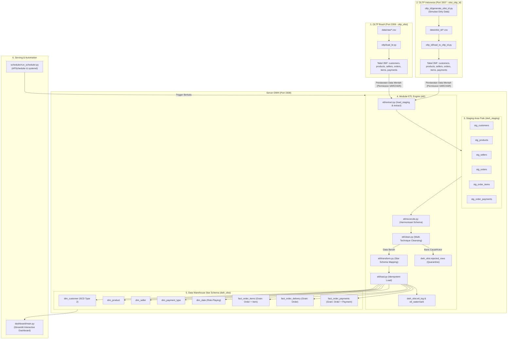
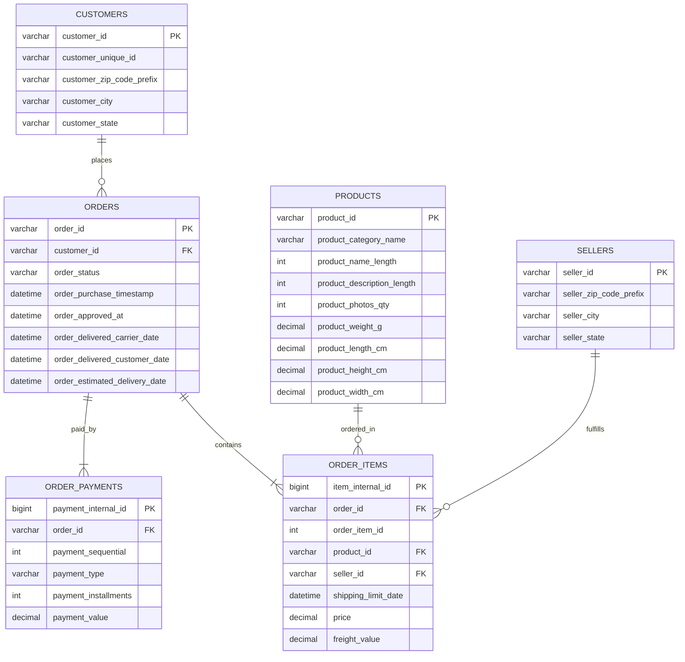
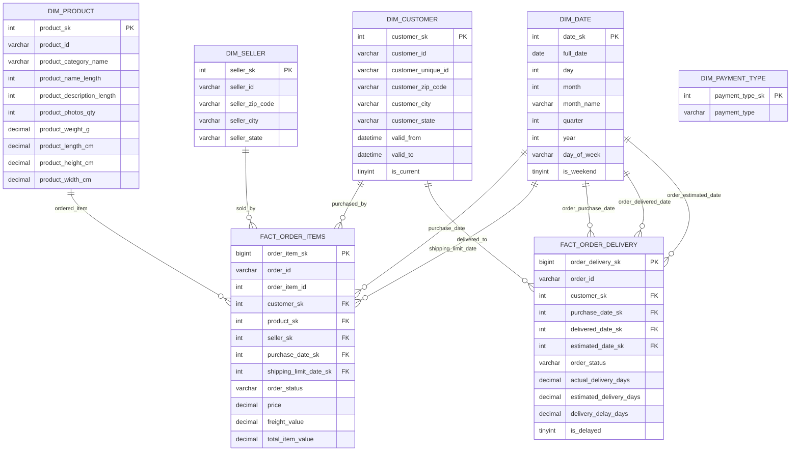

# 🛒 Olist E-Commerce: Production-Grade OLTP to DWH Pipeline

Pipeline data engineering end-to-end yang memuat dataset e-commerce Brasil (Olist) dari file CSV mentah ke dalam MySQL OLTP ternormalisasi (3NF), melakukan proses ekstraksi, pembersihan data (*cleansing* multi-teknik), transformasi Star Schema, pemuatan data transaksional yang *idempotent*, otomasi penjadwalan (*scheduler*), serta visualisasi analitik bisnis tingkat lanjut.

---

## 📌 Daftar Isi
1. [Arsitektur Sistem](#-arsitektur-sistem)
2. [Desain Data & Skema ERD](#-desain-data--skema-erd)
   - [ERD OLTP 3NF](#erd-oltp-3nf-database-oltp_olist)
   - [ERD DWH Star Schema](#erd-dwh-star-schema-database-dwh_olist)
3. [Tabel Teknik Cleansing Data](#-tabel-teknik-cleansing-data)
4. [Keputusan Desain Data Warehouse](#-keputusan-desain-data-warehouse)
5. [Struktur Proyek](#-struktur-proyek)
6. [Instalasi & Setup](#-instalasi--setup)
7. [Urutan Menjalankan Pipeline](#-urutan-menjalankan-pipeline)
8. [Panduan Scheduler](#-panduan-scheduler)
9. [Pengujian Otomatis (Testing)](#-pengujian-otomatis-testing)
10. [Business Insights & Hasil Analitik](#-business-insights--hasil-analitik)

---

## 🏗️ Arsitektur Sistem



---

## 🗄️ Desain Data & Skema ERD

### ERD OLTP 3NF (Database: `oltp_olist`)

Skema OLTP dirancang dalam bentuk Third Normal Form (3NF) dengan entitas terpisah, tipe data baku (`INT`, `DECIMAL`, `DATETIME`), serta constraints yang sengaja dilonggarkan agar data mentah dan anomali dapat tersimpan di OLTP tanpa gagal, sebelum dibersihkan oleh pipeline ETL.



---

### ERD DWH Star Schema (Database: `dwh_olist`)

Star Schema memiliki **5 tabel dimensi** dan **2 tabel fakta** independen untuk membedakan grain metrik keuangan tingkat item dan metrik logistik pengiriman tingkat order.



---

## 🧹 Tabel Teknik Cleansing Data

Pipeline ETL menerapkan **4 teknik cleansing komprehensif**. Setiap baris yang gagal divalidasi **TIDAK didrop diam-diam**, melainkan disimpan ke dalam tabel karantina `dwh_olist.rejected_rows` bersama alasan dan rekaman JSON aslinya.

| No | Masalah Kualitas Data | Teknik Cleansing | Implementasi di `etl/clean.py` | Hasil / Tindakan |
|---|---|---|---|---|
| **1** | Kategori produk bernilai NULL (`product_category_name is null`) | **Null Imputation** | Mengganti nilai NULL dengan string `'unknown'` dan dimensi fisik dengan 0 | 610 produk diimputasi; produk tetap masuk ke DWH dan dapat dianalisis tanpa menghilangkan relasi |
| **2** | Timestamp persetujuan pembayaran kosong (`order_approved_at is null`) pada order non-canceled | **Null Validation & Filtering** | Mendeteksi order aktif tanpa otorisasi pembayaran; mengisolasi baris | 14 order ditolak dan dikarantina ke `rejected_rows` karena melanggar integritas finansial |
| **3** | Duplikasi persis (*Exact duplicates*) & duplikasi business key `(order_id, order_item_id)` | **Text Normalization & Deduplication** | Normalisasi teks kota/state (strip whitespace & lowercase), kemudian memfilter duplikasi | Duplikat dieliminasi; baris duplikat dikarantina ke `rejected_rows` |
| **4** | Tanggal pengiriman lebih awal dari pembelian (`delivered < purchase`) | **Temporal Logic Validation** | Komparasi timestamp: `order_delivered_customer_date < order_purchase_timestamp` | Ditolak ke `rejected_rows` dengan alasan `order delivered before purchase timestamp` |
| **5** | Tanggal estimasi pengiriman lebih awal dari pembelian (`estimated < purchase`) | **Temporal Logic Validation** | Komparasi timestamp: `order_estimated_delivery_date < order_purchase_timestamp` | Ditolak ke `rejected_rows` dengan alasan `estimated delivery date before purchase timestamp` |
| **6** | Status `'delivered'` namun tanggal sampai kosong, atau status `'canceled'` namun memiliki tanggal sampai | **Business State Consistency** | Validasi silang antara kolom `order_status` dan `order_delivered_customer_date` | 14 baris kontradiktif dikarantina ke `rejected_rows` |
| **7** | Nilai harga item `<= 0` atau ongkos kirim `< 0` | **Numeric Domain Boundary Validation** | Memastikan `price > 0` dan `freight_value >= 0` | Dikarantina ke `rejected_rows` |
| **8** | Tanggal transaksi di masa depan (*Future Date*, contoh tahun 2035) | **Date Horizon Validation** | Memfilter `order_purchase_timestamp > current_date` | Dikarantina ke `rejected_rows` |
| **9** | Pergeseran kolom (*Column Shift*): `order_status` berisi angka tahun (`'2018'`) atau `payment_type` berisi kode state (`'SP'`, `'RJ'`) | **Domain Set Validation & Shift Quarantine** | Memvalidasi keanggotaan nilai terhadap `VALID_ORDER_STATUSES` dan `VALID_PAYMENT_TYPES` | Dikarantina ke `rejected_rows` dengan alasan terindikasi column shift |

---

## 💡 Keputusan Desain Data Warehouse

### 1. Pemilihan Fakta ke-2: `fact_order_delivery`
- **Grain**: 1 baris per `order_id`.
- **Alasan Pemilihan**: Memisahkan metrik logistik pengiriman dari metrik transaksi item. Setiap order hanya memiliki satu siklus pengiriman dengan metrik: hari aktual, hari estimasi, selisih keterlambatan (*delay days*), dan status keterlambatan (*is_delayed*).

### 2. Penyelesaian Masalah Grain & Cartesian Multiplication
- **Masalah pada Legacy Script**: Dataset flat hasil join menghubungkan tabel `items` dan `payments` pada level order. Jika suatu pesanan memiliki 2 item dan 2 metode pembayaran, akan timbul 4 baris (*Cartesian product*). Menjumlahkan `payment_value` pada baris item menyebabkan nilai pembayaran terhitung ganda (*double-counting*).
- **Solusi**: `fact_order_items` hanya memuat measure tingkat item (`price`, `freight_value`), sementara agregasi order dihitung dengan `COUNT(DISTINCT order_id)`.

### 3. Implementasi SCD Type 2 pada `dim_customer`
- Kolom pelacak historis disediakan: `valid_from`, `valid_to`, dan `is_current`.
- Menggunakan `customer_unique_id` sebagai business key (mengelompokkan repeat order dari customer yang sama).
- Karena dataset publik Olist merupakan snapshot tunggal, seluruh data awal ditandai dengan `is_current = 1` dan `valid_to = NULL`, dengan arsitektur yang siap (*forward-compatible*) menerima pembaruan historis berikutnya.

### 4. Record Unknown (`sk = -1`)
- Setiap tabel dimensi memiliki baris `sk = -1` (Unknown Record).
- Jika terdapat transaksi fakta dengan foreign key yang hilang atau tidak cocok di dimensi, foreign key akan diarahkan ke `-1` sehingga baris fakta **tidak akan dibuang secara diam-diam (*silent drop*)**.

---

## 📁 Struktur Proyek

```
project-oltp-to-dwh/
├── data/
│   └── raw/                     # Dataset Kaggle Olist mentah (CSV koma)
├── legacy/                      # Script lama temanku (DIARSIPKAN & TIDAK DIUBAH)
│   ├── load_oltp.py
│   ├── create_star_schema.py
│   ├── transform_oltp_to_dwh.py
│   └── analytics.py
├── sql/                         # Definisi skema SQL DDL
│   ├── 01_oltp_ddl.sql          # Staging table & tabel 3NF OLTP
│   ├── 02_dwh_ddl.sql           # Star Schema (5 Dimensi & 2 Fakta)
│   └── 03_support_tables.sql    # etl_log, rejected_rows, etl_watermark
├── oltp/                        # Ekstraksi staging & pemecahan ke 3NF
│   ├── load_staging.py          # Membaca data/raw atau Olist.csv -> olist_raw
│   └── split_to_oltp.py         # Memecah olist_raw -> 3NF normalisasi
├── etl/                         # Pipeline ETL modular
│   ├── config.py                # Koneksi DB aman (URL.create) & konstanta
│   ├── extract.py               # Full load & incremental extract (watermark)
│   ├── clean.py                 # 4 teknik cleansing & karantina
│   ├── transform.py             # Pembentukan dimensi & fakta
│   ├── load.py                  # Dimensi upsert, load fakta transaksional
│   ├── run_etl.py               # Orkestrator utama, logging, audit report
│   └── analytics.py             # 9 query bisnis & analisis multi-fact
├── scheduler/                   # Otomasi penjadwalan
│   ├── run_scheduler.py         # APScheduler cron harian jam 02:00
│   ├── dwh-etl.service          # Unit service systemd
│   └── dwh-etl.timer            # Timer systemd (02:00 AM)
├── reports/                     # Laporan audit kualitas data Before vs After
│   └── data_quality_report_latest.md
├── tests/                       # Pengujian otomatis pytest
│   ├── test_clean.py            # Unit test fungsi cleansing data
│   └── test_dwh_integrity.py    # Uji integritas DWH, FK, grain, & measure
├── inject_dirty_data.py         # Injektor data anomali terkontrol
├── .env.example                 # Template konfigurasi environment
├── requirements.txt             # Dependensi Python
└── README.md                    # Dokumentasi lengkap proyek
```

---

## ⚙️ Instalasi & Setup

### 1. Prasyarat
- Python 3.10+
- Docker & Docker Compose (atau `devenv` / MySQL Server lokal)

### 2. Setup Database via Docker Compose
Jalankan ketiga instance MySQL (OLTP Brazil, OLTP Indonesia, dan DWH/Staging) secara instan:
```bash
docker compose up -d
```
> *Container ports:*  
> - `mysql-oltp-br`: Port **3306** (`oltp_olist`)  
> - `mysql-oltp-id`: Port **3307** (`olist_oltp_id`)  
> - `mysql-dwh`: Port **3308** (`dwh_olist` & `dwh_staging`)  

### 3. Setup Virtual Environment
```bash
python3 -m venv .venv
source .venv/bin/activate
pip install -r requirements.txt
```

### 4. Konfigurasi `.env`
Salin template konfigurasi dan sesuaikan kredensial MySQL kamu:
```bash
cp .env.example .env
```
Isi file `.env`:
```ini
# Database Host & Auth
DB_HOST=127.0.0.1
DB_USER=root
DB_PASSWORD=

# Port Mapping Multi-Database
DB_PORT_OLTP_BR=3306
DB_PORT_OLTP_ID=3307
DB_PORT_DWH=3308

# Database Names
DB_NAME_OLTP_BR=oltp_olist
DB_NAME_OLTP_ID=olist_oltp_id
DB_NAME_DWH=dwh_olist
DB_NAME_STAGING=dwh_staging
```

---

## 🚀 Urutan Menjalankan Pipeline

Jalankan tahapan berikut secara berurutan:

```bash
# 1. Pastikan container database aktif
docker compose up -d

# 2. Inisialisasi skema DWH Star Schema & Support Tables
python dwh/create_star_schema.py --recreate

# 3. Muat data OLTP Brazil (data mentah Kaggle)
python oltp/load_br.py

# 4. Generate & muat OLTP Indonesia (simulasi dirty data terkontrol)
python oltp_id/generate_olist_id.py
python oltp_id/load_to_oltp_id.py

# 5. Jalankan Orkestrator ETL
# (Ekstrak ke dwh_staging -> Cleansing -> Transform -> Load ke dwh_olist)
python etl/run_etl.py

# 6. Jalankan Visualisasi Bisnis Dashboard (Streamlit)
streamlit run dashboard/main.py

# 7. Jalankan Test Suite Pytest (12 Tests: Integrity, Cleansing, Progress)
pytest
```

---

## ⏰ Panduan Scheduler

Tersedia dua opsi penjadwalan produksi:

### Opsi 1: APScheduler (`scheduler/run_scheduler.py`)

1. **Mode Demo (Setiap 1 menit)**:
   ```bash
   python scheduler/run_scheduler.py --demo
   ```
2. **Mode Produksi (Setiap hari pukul 02:00 pagi)**:
   ```bash
   python scheduler/run_scheduler.py
   ```
3. **Trigger Langsung Sekali (*Run Now*)**:
   ```bash
   python scheduler/run_scheduler.py --now
   ```
*Catatan: Menggunakan `max_instances=1` untuk menjamin tidak ada run yang tumpang tindih.*

### Opsi 2: Systemd Service & Timer (Linux Daemon)

Salin unit file ke direktori systemd:
```bash
sudo cp scheduler/dwh-etl.service /etc/systemd/system/
sudo cp scheduler/dwh-etl.timer /etc/systemd/system/
sudo systemctl daemon-reload

# Aktifkan timer harian
sudo systemctl enable --now dwh-etl.timer

# Cek status timer
systemctl list-timers --all | grep dwh-etl
```

---

## 🧪 Pengujian Otomatis (Testing)

Suite pengujian otomatis berbasis `pytest` mencakup:
- **Unit Testing Cleansing**: Null handling, normalisasi teks, deduplikasi business key, logika temporal (*bad logic*), validasi domain status, dan deteksi column shift.
- **Integritas DWH**: Bebas dari FK orphan, keunikan 100% pada grain fakta, keberadaan record Unknown (-1), serta **konsistensi rekonsiliasi measure keuangan** antara OLTP dan DWH:
  $$\sum \text{Price}_{\text{DWH}} + \sum \text{Price}_{\text{Rejected}} = \sum \text{Price}_{\text{OLTP}}$$

Jalankan pengujian:
```bash
python -m pytest -v tests/
```
Output:
```
tests/test_clean.py::test_null_handling PASSED
tests/test_clean.py::test_deduplication_and_text_normalization PASSED
tests/test_clean.py::test_bad_business_logic PASSED
tests/test_clean.py::test_domain_validation_and_column_shift PASSED
tests/test_dwh_integrity.py::test_unknown_records_in_dimensions PASSED
tests/test_dwh_integrity.py::test_fact_order_items_grain_uniqueness PASSED
tests/test_dwh_integrity.py::test_fact_order_delivery_grain_uniqueness PASSED
tests/test_dwh_integrity.py::test_no_orphan_foreign_keys_in_facts PASSED
tests/test_dwh_integrity.py::test_sum_measure_consistency PASSED
tests/test_dwh_integrity.py::test_dim_customer_scd2_structure PASSED

============================== 10 passed in 2.71s ==============================
```

---

## 📈 Business Insights & Hasil Analitik

Dieksekusi dari script `etl/analytics.py`:

1. **Pertumbuhan Penjualan Tahunan**:
   - 2016: 316 order (R$ 46,739)
   - 2017: 44,484 order (R$ 6,009,477)
   - 2018: 53,842 order (R$ 7,532,305)
2. **Top 3 Kategori Produk Terlaris**:
   - `beleza_saude`: R$ 1,258,751 (9,669 item)
   - `relogios_presentes`: R$ 1,204,727 (5,989 item)
   - `cama_mesa_banho`: R$ 1,036,854 (11,114 item)
3. **Korelasi Nilai Order terhadap Keterlambatan Pengiriman (Multi-Fact Query 1)**:
   - *Low Value (< R$ 50)*: Delay Rate 7.47% (Rata-rata 11.56 hari)
   - *Medium Value (R$ 50 - 200)*: Delay Rate 8.18% (Rata-rata 12.76 hari)
   - *High Value (R$ 200 - 500)*: Delay Rate 9.09% (Rata-rata 13.59 hari)
   - *Premium (> R$ 500)*: Delay Rate 9.29% (Rata-rata 14.42 hari)
   *(Insight: Barang premium dan berharga tinggi cenderung membutuhkan waktu packing/penanganan khusus dan memiliki rute kurir khusus sehingga rata-rata waktu sampai sedikit lebih lama).*
4. **Wilayah dengan Tingkat Keterlambatan Tertinggi**:
   - Alagoas (AL): 23.90% telat (Rata-rata 24.59 hari)
   - Maranhão (MA): 19.80% telat (Rata-rata 21.65 hari)
   - Piauí (PI): 15.95% telat (Rata-rata 19.54 hari)

---

## 📊 Dashboard Streamlit (Interaktif)

Dashboard multipage berbasis **Streamlit** yang terkoneksi langsung ke DWH `dwh_olist` via SQLAlchemy + PyMySQL.
Semua query di-cache (`@st.cache_data`) dan tersedia filter sidebar: **Tahun**, **Bulan**, **State Customer**.

### Halaman

| Halaman | File | Konten |
|---------|------|--------|
| 🏠 Home | `dashboard/Home.py` | KPI cards (revenue, order, delivery, delay) + line chart revenue per bulan |
| 🛍️ Sales | `dashboard/pages/1_Sales.py` | Top 10 kategori, revenue per bulan, box plot harga per kategori |
| 🚚 Delivery | `dashboard/pages/2_Delivery.py` | Avg delivery days per bulan, delay rate per state, histogram delivery days |
| 💳 Payment | `dashboard/pages/3_Payment.py` | Distribusi metode (pie), cicilan per segmen nilai, revenue per payment type |
| 👥 Customer | `dashboard/pages/4_Customer.py` | Top 10 state by order, sebaran customer, repeat vs new customer |

### Cara Menjalankan

```bash
# Pastikan .env sudah terkonfigurasi
# Install dependensi jika belum
pip install -r requirements.txt

# Jalankan dashboard
streamlit run dashboard/Home.py
```

Dashboard akan terbuka di browser: **http://localhost:8501**

### Struktur File Dashboard

```
dashboard/
├── Home.py              # Halaman utama (ringkasan eksekutif)
├── utils.py             # Engine, color palette, filter helpers
└── pages/
    ├── 1_Sales.py       # Analisis penjualan
    ├── 2_Delivery.py    # Performa logistik
    ├── 3_Payment.py     # Analisis pembayaran
    └── 4_Customer.py    # Segmentasi pelanggan
```
